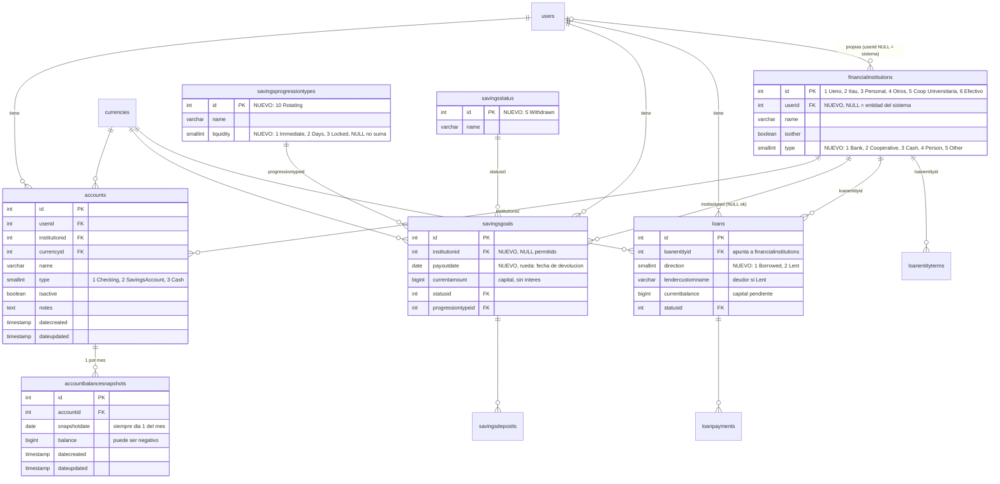

# Modelo de datos — Patrimonio (Net Worth)

Issue: #215 · Epic: #209 (Fase 1. Cimientos)

Objetivo: saber **dónde está cada guaraní**. El patrimonio se calcula siempre a partir de **saldos** (snapshots, `currentamount`, `currentbalance`), nunca sumando movimientos.

## Diagrama



## Entidades financieras

`loanentities` se **renombra** a `financialinstitutions` (`ALTER TABLE ... RENAME`). Los ids y las FKs se conservan, así que `loans` y `loanentityterms` no se rompen. El código no consulta la tabla por nombre (solo usa el enum `LoanEntity`), por lo que no hace falta una vista de compatibilidad.

| id | name | type |
|---|---|---|
| 1 | Ueno | Bank |
| 2 | Itaú | Bank |
| 3 | Personal | Person |
| 4 | Otros | Other (`isother = true`) |
| 5 | Cooperativa Universitaria | Cooperative |
| 6 | Efectivo | Cash |

Para no tocar código existente, las columnas `loans.loanentityid` y `loanentityterms.loanentityid` **no se renombran**.

**Entidades propias del usuario:** la columna nueva `userid` es NULL en las filas del sistema (las de la tabla de arriba). Cada usuario puede crear las suyas desde la app (por ejemplo, otra cooperativa) sin necesidad de una migración. Cada usuario ve las filas con `userid IS NULL OR userid = <usuario>`. El nombre no se puede repetir dentro del mismo usuario.

Ninguna entidad tiene comportamiento especial por id. La Cooperativa Universitaria es una fila más con `type = Cooperative`, así que cualquier otra cooperativa funciona igual. Los ids 3 (Personal) y 4 (Otros) se mantienen por compatibilidad con `loans`.

## Liquidez

La liquidez es una propiedad del **tipo**, no de cada registro.

| Liquidez | Valor | Qué incluye |
|---|---|---|
| Inmediata | 1 `Immediate` | todas las `accounts` (efectivo, cuenta a la vista); ahorros personales (tipos 1–5) **con entidad** |
| En días | 2 `Days` | `MutualFund` (9): se retira en cualquier momento, sin vencimiento, pero el rescate no es instantáneo (tarda 24 a 72 h) |
| Bloqueada hasta el vencimiento | 3 `Locked` | `Scheduled` (6), `FixedDeposit` (7), `CDA` (8), `Rotating` (10), préstamos `Lent` |
| No suma | — | ahorros personales (tipos 1–5) **sin entidad** |

**Ahorros personales (tipos 1–5):** su liquidez depende de dónde está la plata.

- **Con `institutionid`:** la plata está depositada en esa entidad y se puede retirar en cualquier momento, por ejemplo los ahorros personales en la Cooperativa Universitaria. Suman como **inmediata**.
- **Sin `institutionid`:** la meta es solo un "sobre" (la plata está en alguna cuenta que ya se cuenta por snapshot). No suma.

La liquidez de los productos financieros (tipos 6–10) se guarda en `savingsprogressiontypes.liquidity`, para que se pueda consultar desde SQL y desde el futuro servidor MCP. Para los tipos 1–5 esa columna queda en NULL y se aplica esta regla:

```text
liquidez efectiva = type.liquidity ?? (goal.institutionid IS NOT NULL ? Immediate : no suma)
```

Las cuentas siempre son inmediatas, y los préstamos otorgados siempre bloqueados.

### Regla contra el doble conteo

Cada guaraní se registra **en un solo lugar**:

- Si la plata de una entidad está registrada como ahorros en my-events (por ejemplo, los ahorros personales en la Coop Universitaria), **no** se crea además una `account` a la vista para esa entidad.
- Una `account` se usa solo para plata que no figura en ningún ahorro: efectivo, cuentas sueldo, el excedente de una entidad, etc.

## Reglas del patrimonio

`patrimonio = activos − pasivos`, agrupado por `currencyid` (sin conversión por ahora).

| Concepto | Signo | Valor | Condición |
|---|---|---|---|
| Cuenta | + | `balance` del último snapshot | `isactive = true` |
| Ahorro | + | `currentamount` | la liquidez efectiva no es "no suma" y `statusid IN (Active, Paused, Completed)` |
| Préstamo otorgado | + | `currentbalance` | `direction = Lent` y `statusid = Active` |
| Préstamo recibido | − | `currentbalance` | `direction = Borrowed` y `statusid = Active` |

Notas:
- **Completed suma.** Un `Scheduled` pasa a Completed cuando se paga la última cuota, pero la plata sigue bloqueada hasta el vencimiento. El nuevo estado **`Withdrawn` (5)** marca que ya se cobró o retiró. `Withdrawn` y `Cancelled` no suman.
- **Se usa el capital, no el rendimiento.** `currentamount` es lo depositado menos lo retirado. El interés de Scheduled, CDA y FixedDeposit se muestra como proyección en el calendario de vencimientos (#226), no en el patrimonio.
- `loans.currentbalance` ya es el **capital pendiente**, porque cada pago descuenta `principalAmount`.
- **Rueda:** suma las cuotas pagadas (`currentamount`) hasta la devolución, y al cobrar pasa a `Withdrawn` (ver la sección siguiente).

## Rueda (`Rotating`, tipo 10)

Todavía no está registrada en my-events; se agrega en #218.

| Característica | Rueda | Comparación con los otros tipos |
|---|---|---|
| Interés | **No tiene tasa** (`annual_rate_percentage` NULL, sin rendimiento proyectado) | Scheduled, FixedDeposit, CDA y MutualFund sí generan |
| Aportes | Cuota fija mensual (`baseamount` × `numberofinstallments`) | Igual que Scheduled |
| Retiro anticipado | **No se puede**, salvo que ganes el sorteo | Scheduled, FixedDeposit y CDA tampoco se pueden retirar antes |
| Devolución | Si no ganás, hasta unos 6 meses **después** de la última cuota | Las demás vencen en `expectedenddate` |
| Monto devuelto | Lo aportado o un poco más. Se registra el **monto real** al cobrar (`payoutamount`). | — |
| Liquidez | Bloqueada (3) | — |

### Dos finales posibles

#### A. Ganás el sorteo

1. Cobrás un monto grande antes de terminar el plan.
2. Las cuotas que faltan quedan en `Skipped` y dejás de pagar. **No queda deuda.**
3. Se registran `payoutamount` (lo que cobraste) y `payoutdate` (la fecha real), y la meta pasa a `Withdrawn`.

#### B. No ganás

1. **Active:** pagás todas las cuotas y `currentamount` crece.
2. **Completed:** al pagar la última cuota. La plata sigue congelada hasta la devolución y **sigue sumando** (por `currentamount`).
3. **Withdrawn:** al cobrar. Se registran `payoutamount` (puede ser mayor que lo aportado) y la `payoutdate` real.

### Campos

- `payoutdate DATE`: es obligatoria para la rueda. Mientras no se cobra es la fecha **estimada**; por defecto, `expectedenddate` + 6 meses, y se puede editar. Al cobrar se reemplaza por la fecha real. No se valida que sea mayor o igual a `expectedenddate`, porque en el final A es anterior.
- `payoutamount BIGINT NULL`: es el monto efectivamente devuelto, y solo se carga al pasar a `Withdrawn`. La diferencia `payoutamount − currentamount` es la ganancia real, si la hubo.

En el patrimonio la rueda suma `currentamount` (lo aportado) hasta que pasa a `Withdrawn`. Después, la plata cobrada pasa a una cuenta o a otro ahorro. El calendario de vencimientos (#226) muestra la `payoutdate` estimada como cobro.

### Qué tipos tienen cuotas

| Con cuotas (filas en `savingsinstallments`) | Sin cuotas |
|---|---|
| Scheduled (6), Rotating (10) | FixedDeposit (7) y CDA (8): un solo depósito, y `numberofinstallments` = **plazo en meses** |
| | MutualFund (9): aportes y retiros libres |

## Migraciones (en `resources/db.sql`)

| Parte | Issue | Cambios |
|---|---|---|
| 19 | #216 | `ALTER TABLE loanentities RENAME TO financialinstitutions`; `ADD COLUMN type SMALLINT NOT NULL DEFAULT 5 CHECK (type BETWEEN 1 AND 5)`; `ADD COLUMN userid INT NULL REFERENCES users(id) ON DELETE CASCADE`; asignar el tipo a 1–4; `INSERT` de 5 Cooperativa Universitaria y 6 Efectivo; `setval` de la secuencia; índice único sobre `(COALESCE(userid, 0), lower(name))`. |
| 20 | #217 | `savingsgoals.institutionid INT NULL REFERENCES financialinstitutions(id)` + índice. |
| 21 | #218 | `savingsprogressiontypes.liquidity SMALLINT NULL CHECK (liquidity IN (1,2,3))` (9 = 2; 6, 7, 8 y 10 = 3; 1–5 = NULL); tipo `10 Rotating`; agregar 10 a `check_increment_for_progression` (sin incremento) y dejarlo en el grupo `NOT IN (5, 9)` de `check_freeform_nulls` (usa cuotas y monto base); `savingsgoals.payoutdate DATE NULL` + `savingsgoals.payoutamount BIGINT NULL CHECK (payoutamount IS NULL OR payoutamount > 0)` + `CHECK (progressiontypeid <> 10 OR (payoutdate IS NOT NULL AND annual_rate_percentage IS NULL))`; `savingsstatus` `5 Withdrawn`. |
| 22 | #219 | `loans.direction SMALLINT NOT NULL DEFAULT 1 CHECK (direction IN (1,2))`; `CHECK (direction = 1 OR lendercustomname IS NOT NULL)`; `loans.totalratepercentage DECIMAL(5,2) NULL`; `amortizationtype` admite `'flat'`; `CHECK (amortizationtype <> 'flat' OR totalratepercentage IS NOT NULL)`; índice `(userid, direction, statusid)`. |
| 23 | #220 | `CREATE TABLE accounts` (ver el diagrama), `CHECK (type IN (1,2,3))`, índice `(userid, isactive)`. |
| 24 | #221 | `CREATE TABLE accountbalancesnapshots`, `UNIQUE (accountid, snapshotdate)`, `CHECK (snapshotdate = date_trunc('month', snapshotdate)::date)`, `ON DELETE CASCADE` desde `accounts`. |

## Ajustes a otros issues

- **#224:** cambiar "`currentamount` de `savingsgoals` activos" por "ahorros con liquidez efectiva y estado Active, Paused o Completed" (usar la regla de liquidez efectiva).
- **#216:** además del `GET`, permitir que el usuario cree, edite y borre sus propias entidades (solo las suyas; las del sistema son de solo lectura). El selector `institution-selector` necesita un acceso para "agregar entidad". Se puede separar en un issue nuevo si se agranda.
- **#217:** la entidad es obligatoria para los tipos 6–10. Para los tipos 1–5 es opcional, pero **decide si la meta suma al patrimonio**, y en el formulario conviene explicarlo. Asignar la Coop Universitaria a los ahorros personales que ya están cargados.
- **#219:** los préstamos que hacés vos usan una **tasa total sobre el capital**, no una tasa anual. Ejemplo: 500.000 al 10% en 4 meses → interés 50.000, total 550.000, 4 cuotas de 137.500. Para eso se agrega la amortización `'flat'`: interés = capital × `totalratepercentage` / 100, repartido en cuotas iguales. `annualratepercentage` (NOT NULL) guarda la tasa anual equivalente (`total × 12 / cuotas`), que es solo informativa. Se guarda la tasa total aparte porque convertirla a anual y volver pierde precisión (5% en 7 meses = 8,571...%). El deudor queda como texto libre en `lendercustomname`, con la entidad "Personal". `'flat'` también sirve para préstamos recibidos informales. **Redondeo de la cuota:** la cuota calculada se redondea hacia arriba (por ejemplo, 266.700 → 267.000) y esa cuota redondeada pasa a ser la cuota real (`actualinstallmentamount`). El total a cobrar es cuota real × cuotas, y la ganancia es total − capital. Caso real: 508.000 al 5% en 2 cuotas → interés 25.400, cuota 266.700 → 267.000, total 534.000, ganancia 26.000. Hay que definir a qué múltiplo redondear (1.000 en el ejemplo).
- **#220:** quitar "Coop Universitaria (vista)" de los criterios de aceptación, porque esa plata ya está en los ahorros personales (regla contra el doble conteo).
- **#218:** incluye la columna `liquidity` y el estado `Withdrawn` (Parte 21), además de la rueda. Cambiar "cobro en una fecha incierta (sorteo o fin del plan)" por "devolución en una fecha fija posterior a la última cuota, sin retiro anticipado". El campo pasa a ser `payoutdate`, **obligatorio**, en lugar de "fecha estimada opcional". Agregar `payoutamount` y la acción "Registrar cobro" para los dos finales (ganó el sorteo, o devolución al final). Al ganar, las cuotas pendientes pasan a `Skipped`. Agregar el 10 a `validTypes` en `saving-manager.service.ts`.
